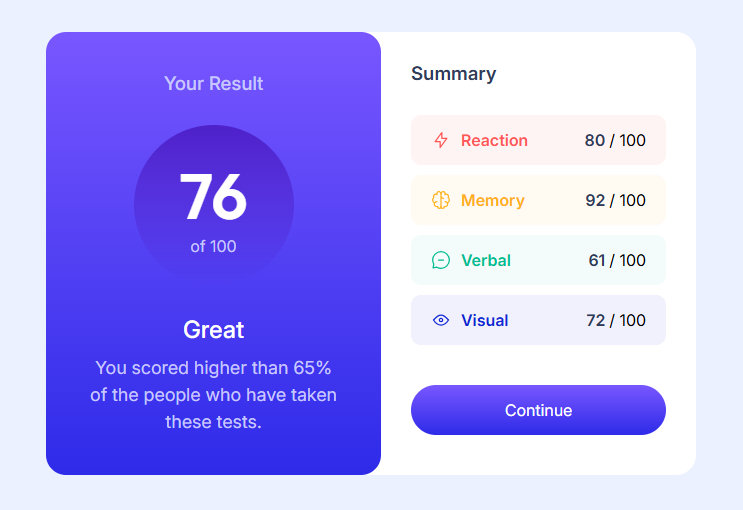
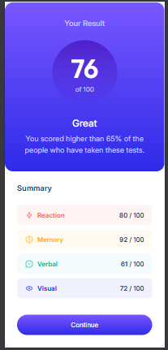

# Frontend Mentor - Results summary component solution

This is a solution to the [Results summary component challenge on Frontend Mentor](https://www.frontendmentor.io/challenges/results-summary-component-CE_K6s0maV). Frontend Mentor challenges help you improve your coding skills by building realistic projects. 

## Table of contents

- [Overview](#overview)
  - [The challenge](#the-challenge)
  - [Screenshot](#screenshot)
  - [Links](#links)
- [My process](#my-process)
  - [Built with](#built-with)
  - [What I learned](#what-i-learned)
  - [Continued development](#continued-development)
  - [AI Collaboration](#ai-collaboration)
- [Author](#author)

## Overview

### The challenge

Users should be able to:

- View the optimal layout for the interface depending on their device's screen size
- See hover and focus states for all interactive elements on the page
- **Bonus**: Use the local JSON data to dynamically populate the content

### Screenshot

### Links

- Solution URL:(https://github.com/60secondbrocode-lang/results-summary-component)
- Live Site URL:( https://60secondbrocode-lang.github.io/results-summary-component/)

## My process

### Built with

- Semantic HTML5 markup
- CSS 

### What I learned

How fixed units are affected to layout , and how flex wrap  property work when it comes to be responsive for base on individuals' device.

### Continued development

There are many things left to develop especially debugging.

### AI Collaboration

I mostly use gemini which is free sources and limitless , i mostly let it guid it through in stead of giving me exact solution for each error

## Author

- Website - [O Zai Par](https://github.com/60secondbrocode-lang)
- Frontend Mentor - [@O Zai Par](https://www.frontendmentor.io/profile/60secondbrocode-lang)

